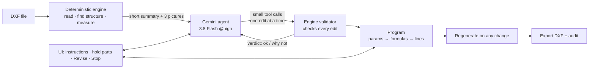
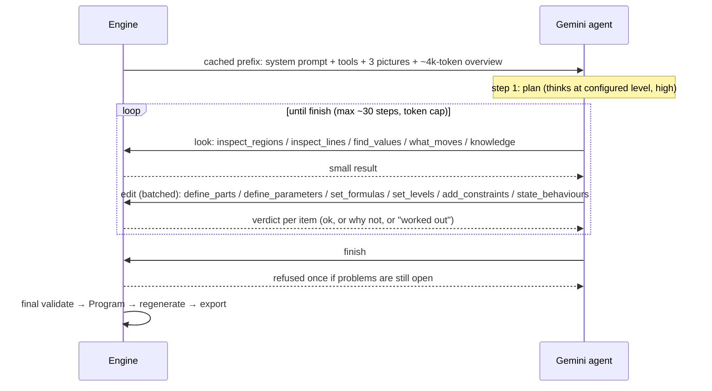
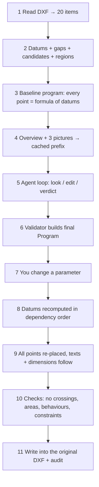

# dxf-autoparam — architecture in plain words

**Goal:** take any existing DXF (bridge GAD, box culvert, slab, girder, ...) and make it *parametric*: change one
size (e.g. `ClearSpan`) and the whole drawing follows — lines, notes, dimensions — then export a new DXF.
Nothing is written for one specific drawing.

**Split of work:** Gemini *understands* (what the parts are, which sizes matter, how they relate).
The deterministic engine *checks and calculates*. Gemini never moves a line; the engine does.



---

## Part 1 — The deterministic engine (no AI at all)

It turns a DXF into a *program* that reproduces the drawing exactly, then lets you change numbers in it.

```
 DXF
  │ READ         dxf_read, dxf_repair    lines, arcs, text, dimensions, hatches  → "items"
  │ DATUMS       analyse                 set-out lines that many shapes share:
  │                                       x1 x2 x3 … (vertical)   y1 y2 … (horizontal)
  │ GAPS         analyse                 distance between neighbouring datums: x3 − x2 = 3000
  │ CANDIDATES   analyse                 equal gaps grouped → possible sizes (c1, c2 …), ranked by confidence
  │ REGIONS      topology                closed shapes found from loose lines (walls, slabs, cells),
  │                                       with holes, neighbours, hatch fill, which lines bound them
  │ PROGRAM      build, program          every point = formula of datums:  x = x2 + 0.5·(x3 − x2)
  │                                       (with no change it reproduces the drawing: error < 0.001 mm)
  ▼
 PROGRAM  =  parameters  →  formulas  →  datums  →  geometry
```

**Making a size a parameter (closed form, no iterative solver):**

```
 before:  x3 = 5300 (a fixed number)               gap x3 − x2 = 3000
 name it: Size = 3000                              x3 = x2 + Size
 change:  Size = 3300  →  x3 moves 300  →  every point built on x3 moves with it
```

**What the engine also does:**

| Job | How, in simple words |
|---|---|
| Measure what a parameter moves | Change it a bit, regenerate, see which regions grow / shrink / move / stay ("impact") |
| Decide who sets a line | One fixed order: AI-stated > named dimension > constraint > held > existing > kept |
| Named dimension drives its lines | If a size has a name and a measured gap, that gap IS the parameter |
| "Worked out" sizes | A size that is just the result of others is kept as a relation, with the reason |
| Constraints | Linear rules (e.g. slope band) enforced in closed form; conflicts are reported with inputs |
| Behaviours | "If A grows, part B grows in x" — checked against the measured impact, not believed |
| Notes & dimensions follow | Texts/dimension values are re-linked to the lines they describe |
| Heal breaks | If growing a size breaks a shape, the engine explains why (V8) and repairs growth where it can |
| Learn from your edit | You drag something; least squares finds the relation behind it |
| Export | Write changed entities into the original DXF, audit it (0 errors) |
| Property check | `dxf-autoparam check` runs these on every sample drawing, no AI, no cost |

**What it cannot know alone:** that 3000 is a "clear span", that some regions are a wing wall, which sizes a
designer cares about, or what "V.C. 5800" means. That is what Gemini adds.

---

## Part 2 — How Gemini parametrizes (the agent)

Old way (removed as default): send the whole drawing, ask Gemini to write the full JSON → ~89k output tokens
and long blank thinking. **New way:** a small summary, then small tool calls, each checked at once.



**The tools Gemini has**

| Kind | Tool | Use |
|---|---|---|
| Look (read-only) | `inspect_regions`, `inspect_lines`, `find_values`, `what_moves`, `knowledge` | "what is this region / which gap is 3000 / what moves if I change X" |
| Edit (batched) | `define_parts`, `define_parameters`, `set_formulas`, `set_levels`, `add_constraints`, `state_behaviours`, `set_structure`, `remove` | name parts (as a tree: assembly → component → subcomponent), name sizes, relate them |
| End | `finish` | only when nothing is open |

**Efficiency tricks**
- Explicit prompt cache of system + tools + pictures + overview (~96% of input tokens cached on repeats).
- Batch tools: many items per call, not one call per item.
- Old tool results trimmed to their verdicts (keeps the last 8 steps in full).
- Nudge, then refuse, endless "just looking"; hard caps on steps and output tokens.
- Per-step disk cache; 3.7 Flash fallback on 429/503/504; every step uses the configured thinking level.

**Where you steer** (UI): instruction box ("parametrize the wing wall, keep the existing culvert"), hold /
exclude parts, drop constraints, Revise (the agent starts from the current answer), ■ Stop Gemini.
Live: its thinking summaries, tool calls and verdicts stream into the UI.

---

## Part 3 — End to end

```
 1 Read the DXF
 2 Engine finds datums, gaps, candidate sizes, regions
 3 Engine builds the overview + pictures (cached)
 4 Gemini plans, then looks and edits in small steps
 5 Engine validates every edit and answers at once
 6 Engine builds the Program (params → formulas → lines) and measures each parameter's impact
 7 You change a value (slider) → engine regenerates → UI shows drawing, notes follow
 8 Export a new DXF (audited)
```

## Safety nets
- Gemini 3.8 Flash @high default; 3.7 Flash fallback; answers cached on disk.
- No structure words in the engine (guarded by a test); `check` proves the same properties on every drawing.
- No secrets in code: env / `.env` and Google ADC only.

## Where things live

| Area | Files |
|---|---|
| Read/write DXF | `dxf_read.py`, `dxf_repair.py`, `dxf_write.py` |
| Understand geometry | `analyse.py`, `topology.py`, `cadjson.py`, `render.py` |
| Intent + validation | `intent.py`, `validator.py`, `graph.py`, `learn.py` |
| Model + regeneration | `program.py`, `regen.py`, `build.py` |
| Gemini | `ai/vertex.py` (client, cache, streaming), `ai/agent.py` (tools, workbench), `ai/prompt.py`, `ai/schema.py` |
| UI / CLI | `server.py`, `static/index.html`, `cli.py` |
| Checks | `robustness.py`, `tests/` |

Deeper detail: `docs/DESIGN_INTENT.md`.

---

## Part 4 — What data goes to Gemini

Gemini never receives the DXF file or the full entity list. Everything is derived by the engine and kept small.
(Examples below are real output for `examples/two_cell_box_section.dxf`, trimmed.)

### A. Once per run — the cached prefix (re-used on every step, ~96% cached)

| Piece | What it is |
|---|---|
| System prompt | The agent playbook: how to read the overview, work in small batches, what the verdicts mean |
| Tool definitions | The tool names and argument schemas (below) |
| 3 pictures | faithful drawing · drawing with line/region labels · region map (each region coloured and numbered) |
| Overview (~4k tokens) | The compact JSON table of the whole view: |

```json
{"drawing": {"units": "mm (levels m)", "extent_mm": [-150,-150,7150,3750], "entities": 20, "symmetry_axes": {"x": "x6"}},
 "regions [id, width, height, edge lines left/right/bottom/top, fill, inside, touches, notes inside]":
   [["R1", 7000, 3750, "x1/x11/y1/y6", "ANSI31", "", "R2:i R3:i R4:b", ""],
    ["R2", 3000, 3000, "x2/x5/y2/y5", "", "R1", "R1:i", "HAUNCH 150×150"]],
 "lines [id, at mm, set out as]": [["x2", 350, "ax13 - 0.5 * OpenX1"], ["x6", 3500, "3500"]],
 "texts [id, text, region]": [["T8", "2 CELL RCC BOX 3.000 × 3.000 m", null]],
 "dimensions [id, value, text, candidate]": [["D10", 3000, "<>", "c4"]],
 "stated_levels [line, words, m]": [],
 "candidates [id, kind, value, axes, occurrences, first pair, drawing says]": [["c4", "void", 3000, "x", 2, "x2-x5", ""]],
 "concept names (use for parts and parameters)": "ClearSpan, ClearHeight, Abutment, BottomSlab, ...",
 "structure families [id, label, parts]": [["rcc_box", "RCC box", ["box","courses","wing_wall","track"]]]}
```
Then the task text: "parametrize this view", plus **your instructions** (if any) and, on Revise, the current state.

### B. Per step — what each tool sends back

**Look tools (read-only)** — small answers, only what was asked:

| Tool call | What comes back (example) |
|---|---|
| `inspect_regions(["R2"])` | `{"R2": {"width":3000,"height":3000,"inside_region":"R1","edges":{"left":{"line":"x2","formula":"ax13 - 0.5 * OpenX1"},…},"touches":["R1 (inside, 11648 mm)"],"notes_inside":["T7: HAUNCH 150×150"],"sizes_across":[{"candidate":"c4","value":3000,"kind":"void","between":["x2","x5"],"occurrences":2}]}}` |
| `inspect_lines(["x2"])` | `{"x2": {"axis":"x","at_mm":350,"formula":"ax13 - 0.5 * OpenX1","chain":["x2 = ax13 - …","x5 = x6 - 0.5 * ThkX4","x6 = 3500"],"moved_by":["OpenX1","ThkX4"]}}` |
| `find_values(value_mm=3000)` | `[{"candidate":"c4","value":3000,"kind":"void","axes":["x"],"occurrences":2,"between":[["x2","x5"],["x7","x10"]],"confidence":0.99}]` |
| `what_moves("ClearSpan")` | which regions grow / shrink / move / stay fixed (x and y) when that parameter changes (measured by regenerating) |
| `knowledge(["clear span"])` | a few lines of domain definitions for that concept |

**Edit tools (batched)** — Gemini sends items, e.g.
`define_parameters(items=[{"name":"ClearSpan","part":"Box","candidate":"c4"}])`, and gets one verdict per item:

| Result | Meaning |
|---|---|
| `{"ok": true}` | accepted and checked |
| `{"ok": true, "worked_out": "…"}` | not an independent size; kept as a measured relation, with the reason |
| rejection with reason, e.g. `x1→y1 measures 0.0 mm` | mixed axes / unknown id / breaks geometry — fix and resend |
| status block | `{"parts":1,"regions_without_part":3,"parameters":0,"open_problems":0}` — what is still left to do |

### C. What never goes to Gemini
The DXF file itself, raw coordinates of every entity, secrets/keys (the engine holds credentials), and old tool
results beyond the last 8 steps (they are trimmed to their verdicts).

---

## Part 5 — The full pipeline, step by step (what goes in, what comes out, what moves)

Worked example with real numbers: `examples/two_cell_box_section.dxf` (20 entities), parameter `ClearSpan`.
Run offline, no Gemini.



| # | Stage | Input → output | Example (real) |
|---|---|---|---|
| 1 | **Read** (`dxf_read`) | DXF file → list of items with points, role, layer | 20 items: lines/polylines, a hatch, texts T7/T8, dimensions D9…D19 |
| 2 | **Analyse** (`analyse`, `topology`) | items → datums, gaps, clusters, regions | 22 datums (`x0…x12`, `ax13`, `y0…y6`…); candidate `c4` = void 3000 mm ×2 on x; regions R1 (7000×3750 concrete, hatch ANSI31), R2/R3 (the two 3000×3000 cells, inside R1), R4 (7300×150 PCC) |
| 3 | **Baseline program** (`build`, `program`) | datums + gaps → one formula per datum | `x6 = 3500`, `x5 = x6 - 0.5*ThkX4`, `x2 = ax13 - 0.5*OpenX1`; unchanged values reproduce the drawing with error < 0.001 mm |
| 4 | **Describe** (`agent.overview`, `render`) | analysis → ~4k-token overview + 3 PNGs | see Part 4; cached explicitly at Vertex |
| 5 | **Agent loop** (`ai/agent`) | Gemini ↔ workbench, small tool calls | it names `Box`, `CellLeft`, `CellRight`, picks `c4` → `ClearSpan`, states "ClearSpan grows → Box grows in x" |
| 6 | **Validate + build** (`validator`, `intent`) | accepted edits → final `Program` | the datum formulas that used the gap now use the parameter: `x2 = ax13 - 0.5 * ClearSpan`, `x10 = ax14 + 0.5 * ClearSpan`; precedence picks who owns each line |
| 7 | **You edit** (UI slider / API) | `{"ClearSpan": 3300}` | the UI sends the new value; nothing else |
| 8 | **Recompute datums** (`program.datum_values`) | params → every datum, in dependency order (a cycle is an error naming the loop) | 10 of 22 datums move: `ax13 1850→1700`, `ax14 5150→5300`, `x2 350→50`, `x10 6650→6950`, `x11 7000→7300`, `x1 0→-300` … centre wall `x6 = 3500` stays |
| 9 | **Re-place everything** (`regen.place`) | datums → new points for every item; text links; radii | 17 of 20 items move; overall width 7300 → 7900 mm (each cell +300, centre wall fixed, outer walls follow) |
| 10 | **Check** (`regen._check_program`) | new geometry → issues | no self-crossings, areas stay positive, behaviours and constraints still hold; here `issues = []`. A break is named (V8) instead of silently drawn |
| 11 | **Export** (`dxf_write`) | regenerated points → the *original* DXF with entities moved | 20 entities updated, 11 dimensions re-rendered, 0 failed, audit 0 errors; unsupported types left exactly as they were |

### How a parameter "draws" the geometry
1. A parameter is just a named number (`ClearSpan = 3000`).
2. Datum lines are formulas of parameters and other datums (`x2 = ax13 - 0.5 * ClearSpan`).
3. Every vertex of every item is a linear form of datums, recorded at read time.
4. Changing the number → datums recomputed in dependency order → every vertex re-evaluated. No solver, no
   iteration, so the result is exact and instant.
5. Items on moved datums follow: lines stretch, rectangles resize, circles re-centre, hatch boundaries follow
   their regions, dimensions are re-measured, notes with a linked number are rewritten.

### How notes and dimensions follow
- **Dimensions** carry the points they measure; they are re-rendered from the new points (11 re-rendered above).
- **Notes** with a number linked to a datum / parameter / relation (`text_links`) get the new number (decimals
  preserved). A note nobody linked stays as written — here "2 CELL RCC BOX 3.000 × 3.000 m" would only follow once
  its numbers are tied to named sizes (honest limit, listed in the project state).

### Who decides what, one line each
| Question | Decided by |
|---|---|
| What are the parts, names, which sizes matter | Gemini (agent), then checked |
| Does a size really drive these lines | Engine: it regenerates and measures |
| Who sets a line when two sources want it | Engine: fixed precedence (ai > dimension > constraint > held > existing > kept) |
| What the new geometry is | Engine: formulas |
| Is the result valid | Engine: invariants, behaviours, constraints, audit |
| Stop / hold / drop / revise | You, in the UI |

---

## Part 6 — A whole sheet

A GAD sheet holds many views of one structure. `sheet.py` finds them (frame, panel rules, pieces of geometry merged by
containment, satellites and titles; tables, notes, title block), `crossview.py` analyses views drawn in projection as
ONE unit (a face they share is one set-out line) and binds sizes separate views state into a shared parameter, checks
every change on the regenerated sheet and commits it only when everything holds. `workspace.py` + `static/workspace.html`
are the canvas workspace; `ai/sheet_ai.py` runs Gemini in checked stages. The full design, the measurements and what
remains: `docs/MULTIVIEW.md`.
