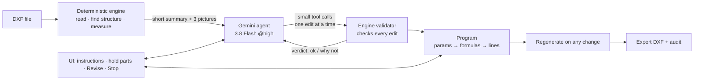
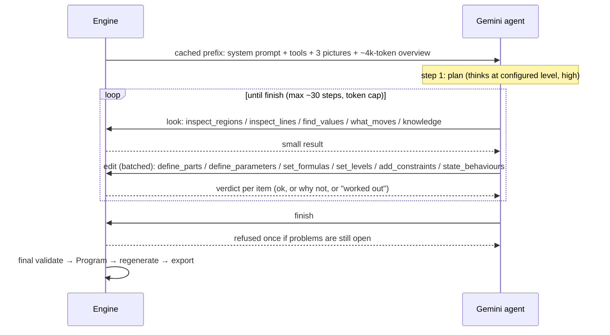
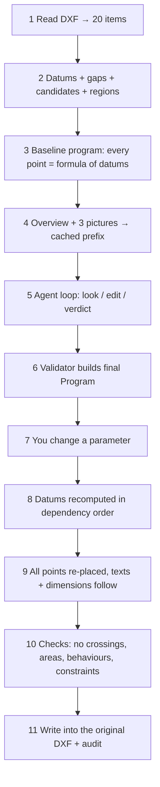

# dxf-autoparam — architecture in plain words

**Goal:** take any existing DXF (bridge GAD, box culvert, slab, girder, ...) and make it *parametric*: change one
size (e.g. `ClearSpan`) and the whole drawing follows — lines, notes, dimensions — then export a new DXF.
Nothing is written for one specific drawing.

**Split of work:** Gemini *understands* (what the parts are, which sizes matter, how they relate).
The deterministic engine *checks and calculates*. Gemini never moves a line; the engine does.



---

## Part 1 — The deterministic engine (no AI at all)

It turns a DXF into a *program* that reproduces the drawing exactly, then lets you change numbers in it.

```
 DXF
  │ READ         dxf_read, dxf_repair    lines, arcs, ellipses, splines, text, dimensions, hatches  → "items"
  │                                       (an ellipse arc or a spline is set out from its two ends and redrawn
  │                                       stretched between them; one the size of the writing is a mark)
  │ DATUMS       analyse                 set-out lines that many shapes share:
  │                                       x1 x2 x3 … (vertical)   y1 y2 … (horizontal)
  │ GAPS         analyse                 distance between neighbouring datums: x3 − x2 = 3000
  │ CANDIDATES   analyse                 equal gaps grouped → possible sizes (c1, c2 …), ranked by confidence
  │ REGIONS      topology                closed shapes found from loose lines (walls, slabs, cells),
  │                                       with holes, neighbours, hatch fill, which lines bound them
  │ PROGRAM      build, program          every point = formula of datums:  x = x2 + 0.5·(x3 − x2)
  │                                       (with no change it reproduces the drawing: error < 0.001 mm)
  ▼
 PROGRAM  =  parameters  →  formulas  →  datums  →  geometry
```

**Making a size a parameter (closed form, no iterative solver):**

```
 before:  x3 = 5300 (a fixed number)               gap x3 − x2 = 3000
 name it: Size = 3000                              x3 = x2 + Size
 change:  Size = 3300  →  x3 moves 300  →  every point built on x3 moves with it
```

**What the engine also does:**

| Job | How, in simple words |
|---|---|
| Measure what a parameter moves | Change it a bit, regenerate, see which regions grow / shrink / move / stay ("impact") |
| Decide who sets a line | One fixed order: AI-stated > named dimension > constraint > held > existing > kept |
| Named dimension drives its lines | If a size has a name and a measured gap, that gap IS the parameter |
| "Worked out" sizes | A size that is just the result of others is kept as a relation, with the reason |
| Constraints | Linear rules (e.g. slope band) enforced in closed form; conflicts are reported with inputs |
| Behaviours | "If A grows, part B grows in x" — checked against the measured impact, not believed |
| Notes & dimensions follow | Texts/dimension values are re-linked to the lines they describe |
| Heal breaks | If growing a size breaks a shape, the engine explains why (V8) and repairs growth where it can |
| Learn from your edit | You drag something; least squares finds the relation behind it |
| Export | Write changed entities into the original DXF, audit it (0 errors) |
| Property check | `dxf-autoparam check` runs these on every sample drawing, no AI, no cost |

**What it cannot know alone:** that 3000 is a "clear span", that some regions are a wing wall, which sizes a
designer cares about, or what "V.C. 5800" means. That is what Gemini adds.

---

## Part 2 — How Gemini parametrizes (the agent)

Old way (removed as default): send the whole drawing, ask Gemini to write the full JSON → ~89k output tokens
and long blank thinking. **New way:** a small summary, then small tool calls, each checked at once.



**The tools Gemini has**

| Kind | Tool | Use |
|---|---|---|
| Look (read-only) | `inspect_regions`, `inspect_lines`, `find_values`, `what_moves`, `knowledge` | "what is this region / which gap is 3000 / what moves if I change X" |
| Edit (batched) | `define_parts`, `define_parameters`, `set_formulas`, `set_levels`, `add_constraints`, `state_behaviours`, `set_structure`, `remove` | name parts (as a tree: assembly → component → subcomponent), name sizes, relate them |
| End | `finish` | only when nothing is open |

**Efficiency tricks**
- Explicit prompt cache of system + tools + pictures + overview (~96% of input tokens cached on repeats).
- Batch tools: many items per call, not one call per item.
- Old tool results trimmed to their verdicts (keeps the last 8 steps in full).
- Nudge, then refuse, endless "just looking"; hard caps on steps and output tokens.
- Per-step disk cache; 3.7 Flash fallback on 429/503/504; every step uses the configured thinking level.

**Where you steer** (UI): instruction box ("parametrize the wing wall, keep the existing culvert"), hold /
exclude parts, drop constraints, Revise (the agent starts from the current answer), ■ Stop Gemini.
Live: its thinking summaries, tool calls and verdicts stream into the UI.

---

## Part 3 — End to end

```
 1 Read the DXF
 2 Engine finds datums, gaps, candidate sizes, regions
 3 Engine builds the overview + pictures (cached)
 4 Gemini plans, then looks and edits in small steps
 5 Engine validates every edit and answers at once
 6 Engine builds the Program (params → formulas → lines) and measures each parameter's impact
 7 You change a value (slider) → engine regenerates → UI shows drawing, notes follow
 8 Export a new DXF (audited)
```

## Safety nets
- Gemini 3.8 Flash @high default; 3.7 Flash fallback; answers cached on disk.
- No structure words in the engine (guarded by a test); `check` proves the same properties on every drawing.
- No secrets in code: env / `.env` and Google ADC only.

## Where things live

| Area | Files |
|---|---|
| Read/write DXF | `dxf_read.py`, `dxf_repair.py`, `dxf_write.py` |
| Understand geometry | `analyse.py`, `topology.py`, `cadjson.py`, `render.py` |
| Intent + validation | `intent.py`, `validator.py`, `graph.py`, `learn.py` |
| Model + regeneration | `program.py`, `regen.py`, `build.py` |
| Gemini | `ai/vertex.py` (client, cache, streaming), `ai/agent.py` (tools, workbench), `ai/prompt.py`, `ai/schema.py` |
| UI / CLI | `server.py`, `static/index.html`, `cli.py` |
| Checks | `robustness.py`, `tests/` |
| What is parametric, part by part | `coverage.py` (each DIMENSION: driven / unnamed / fixed / kept / unread, on the parts it measures) |
| Why a change was refused | `refusal.py` (the failed check, its entities, and its kind), `crossview.SheetModel.explain` |
| A relation, checked before it is bound | `relations.py` (`check_relation`) |
| Views in their own coordinates; redrawing a view at another scale | `frames.py`, `rescale.py` |
| Component knowledge (production) | `knowledge/library/bridge/components.json` (cards: parameters, defaults, relations, sources) |
| Measuring it | `tools/param_bench.py` + `tools/bench_cases.json` (docs/PARAM_BENCH.md), `tools/component_inventory.py` |

Deeper detail: `docs/DESIGN_INTENT.md`.

---

## Part 4 — What data goes to Gemini

Gemini never receives the DXF file or the full entity list. Everything is derived by the engine and kept small.
(Examples below are real output for `examples/two_cell_box_section.dxf`, trimmed.)

### A. Once per run — the cached prefix (re-used on every step, ~96% cached)

| Piece | What it is |
|---|---|
| System prompt | The agent playbook: how to read the overview, work in small batches, what the verdicts mean |
| Tool definitions | The tool names and argument schemas (below) |
| 3 pictures | faithful drawing · drawing with line/region labels · region map (each region coloured and numbered) |
| Overview (~4k tokens) | The compact JSON table of the whole view: |

```json
{"drawing": {"units": "mm (levels m)", "extent_mm": [-150,-150,7150,3750], "entities": 20, "symmetry_axes": {"x": "x6"}},
 "regions [id, width, height, edge lines left/right/bottom/top, fill, inside, touches, notes inside]":
   [["R1", 7000, 3750, "x1/x11/y1/y6", "ANSI31", "", "R2:i R3:i R4:b", ""],
    ["R2", 3000, 3000, "x2/x5/y2/y5", "", "R1", "R1:i", "HAUNCH 150×150"]],
 "lines [id, at mm, set out as]": [["x2", 350, "ax13 - 0.5 * OpenX1"], ["x6", 3500, "3500"]],
 "texts [id, text, region]": [["T8", "2 CELL RCC BOX 3.000 × 3.000 m", null]],
 "dimensions [id, value, text, candidate]": [["D10", 3000, "<>", "c4"]],
 "stated_levels [line, words, m]": [],
 "candidates [id, kind, value, axes, occurrences, first pair, drawing says]": [["c4", "void", 3000, "x", 2, "x2-x5", ""]],
 "concept names (use for parts and parameters)": "ClearSpan, ClearHeight, Abutment, BottomSlab, ...",
 "structure families [id, label, parts]": [["rcc_box", "RCC box", ["box","courses","wing_wall","track"]]]}
```
Then the task text: "parametrize this view", plus **your instructions** (if any) and, on Revise, the current state.

### B. Per step — what each tool sends back

**Look tools (read-only)** — small answers, only what was asked:

| Tool call | What comes back (example) |
|---|---|
| `inspect_regions(["R2"])` | `{"R2": {"width":3000,"height":3000,"inside_region":"R1","edges":{"left":{"line":"x2","formula":"ax13 - 0.5 * OpenX1"},…},"touches":["R1 (inside, 11648 mm)"],"notes_inside":["T7: HAUNCH 150×150"],"sizes_across":[{"candidate":"c4","value":3000,"kind":"void","between":["x2","x5"],"occurrences":2}]}}` |
| `inspect_lines(["x2"])` | `{"x2": {"axis":"x","at_mm":350,"formula":"ax13 - 0.5 * OpenX1","chain":["x2 = ax13 - …","x5 = x6 - 0.5 * ThkX4","x6 = 3500"],"moved_by":["OpenX1","ThkX4"]}}` |
| `find_values(value_mm=3000)` | `[{"candidate":"c4","value":3000,"kind":"void","axes":["x"],"occurrences":2,"between":[["x2","x5"],["x7","x10"]],"confidence":0.99}]` |
| `what_moves("ClearSpan")` | which regions grow / shrink / move / stay fixed (x and y) when that parameter changes (measured by regenerating) |
| `knowledge(["clear span"])` | a few lines of domain definitions for that concept |

**Edit tools (batched)** — Gemini sends items, e.g.
`define_parameters(items=[{"name":"ClearSpan","part":"Box","candidate":"c4"}])`, and gets one verdict per item:

| Result | Meaning |
|---|---|
| `{"ok": true}` | accepted and checked |
| `{"ok": true, "worked_out": "…"}` | not an independent size; kept as a measured relation, with the reason |
| rejection with reason, e.g. `x1→y1 measures 0.0 mm` | mixed axes / unknown id / breaks geometry — fix and resend |
| status block | `{"parts":1,"regions_without_part":3,"parameters":0,"open_problems":0}` — what is still left to do |

### C. What never goes to Gemini
The DXF file itself, raw coordinates of every entity, secrets/keys (the engine holds credentials), and old tool
results beyond the last 8 steps (they are trimmed to their verdicts).

---

## Part 5 — The full pipeline, step by step (what goes in, what comes out, what moves)

Worked example with real numbers: `examples/two_cell_box_section.dxf` (20 entities), parameter `ClearSpan`.
Run offline, no Gemini.



| # | Stage | Input → output | Example (real) |
|---|---|---|---|
| 1 | **Read** (`dxf_read`) | DXF file → list of items with points, role, layer | 20 items: lines/polylines, a hatch, texts T7/T8, dimensions D9…D19 |
| 2 | **Analyse** (`analyse`, `topology`) | items → datums, gaps, clusters, regions | 22 datums (`x0…x12`, `ax13`, `y0…y6`…); candidate `c4` = void 3000 mm ×2 on x; regions R1 (7000×3750 concrete, hatch ANSI31), R2/R3 (the two 3000×3000 cells, inside R1), R4 (7300×150 PCC) |
| 3 | **Baseline program** (`build`, `program`) | datums + gaps → one formula per datum | `x6 = 3500`, `x5 = x6 - 0.5*ThkX4`, `x2 = ax13 - 0.5*OpenX1`; unchanged values reproduce the drawing with error < 0.001 mm |
| 4 | **Describe** (`agent.overview`, `render`) | analysis → ~4k-token overview + 3 PNGs | see Part 4; cached explicitly at Vertex |
| 5 | **Agent loop** (`ai/agent`) | Gemini ↔ workbench, small tool calls | it names `Box`, `CellLeft`, `CellRight`, picks `c4` → `ClearSpan`, states "ClearSpan grows → Box grows in x" |
| 6 | **Validate + build** (`validator`, `intent`) | accepted edits → final `Program` | the datum formulas that used the gap now use the parameter: `x2 = ax13 - 0.5 * ClearSpan`, `x10 = ax14 + 0.5 * ClearSpan`; precedence picks who owns each line |
| 7 | **You edit** (UI slider / API) | `{"ClearSpan": 3300}` | the UI sends the new value; nothing else |
| 8 | **Recompute datums** (`program.datum_values`) | params → every datum, in dependency order (a cycle is an error naming the loop) | 10 of 22 datums move: `ax13 1850→1700`, `ax14 5150→5300`, `x2 350→50`, `x10 6650→6950`, `x11 7000→7300`, `x1 0→-300` … centre wall `x6 = 3500` stays |
| 9 | **Re-place everything** (`regen.place`) | datums → new points for every item; text links; radii | 17 of 20 items move; overall width 7300 → 7900 mm (each cell +300, centre wall fixed, outer walls follow) |
| 10 | **Check** (`regen._check_program`) | new geometry → issues | no self-crossings, areas stay positive, behaviours and constraints still hold; here `issues = []`. A break is named (V8) instead of silently drawn |
| 11 | **Export** (`dxf_write`) | regenerated points → the *original* DXF with entities moved | 20 entities updated, 11 dimensions re-rendered, 0 failed, audit 0 errors; unsupported types left exactly as they were |

### How a parameter "draws" the geometry
1. A parameter is just a named number (`ClearSpan = 3000`).
2. Datum lines are formulas of parameters and other datums (`x2 = ax13 - 0.5 * ClearSpan`).
3. Every vertex of every item is a linear form of datums, recorded at read time.
4. Changing the number → datums recomputed in dependency order → every vertex re-evaluated. No solver, no
   iteration, so the result is exact and instant.
5. Items on moved datums follow: lines stretch, rectangles resize, circles re-centre, hatch boundaries follow
   their regions, dimensions are re-measured, notes with a linked number are rewritten.

### How notes and dimensions follow
- **Dimensions** carry the points they measure; they are re-rendered from the new points (11 re-rendered above).
- **Notes** with a number linked to a datum / parameter / relation (`text_links`) get the new number (decimals
  preserved). A note nobody linked stays as written — here "2 CELL RCC BOX 3.000 × 3.000 m" would only follow once
  its numbers are tied to named sizes (honest limit, listed in the project state).

### Who decides what, one line each
| Question | Decided by |
|---|---|
| What are the parts, names, which sizes matter | Gemini (agent), then checked |
| Does a size really drive these lines | Engine: it regenerates and measures |
| Who sets a line when two sources want it | Engine: fixed precedence (ai > dimension > constraint > held > existing > kept) |
| What the new geometry is | Engine: formulas |
| Is the result valid | Engine: invariants, behaviours, constraints, audit |
| Stop / hold / drop / revise | You, in the UI |

---

## Part 6 — A whole sheet

A GAD sheet holds many views of one structure. `sheet.py` finds them (frame, panel rules, pieces of geometry merged by
containment, satellites and titles; tables, notes, title block), `crossview.py` analyses views drawn in projection as
ONE unit (a face they share is one set-out line) and binds sizes separate views state into a shared parameter, checks
every change on the regenerated sheet and commits it only when everything holds. `workspace.py` + `static/workspace.html`
are the canvas workspace; `ai/sheet_ai.py` runs Gemini in checked stages. The full design, the measurements and what
remains: `docs/MULTIVIEW.md`.

---

## Part 7 — Understanding a real GAD together (what was added on 2026-10-22, and why)

A real sheet (173A) showed the gap: the return walls in the longitudinal section were drawn, dimensioned and named, yet none of their own sizes
could be changed. 29 of the unit's 33 undriven dimensions measured gaps the set-out held as constant offsets after the agent's answer, invisible to
every tool the agent read; nothing told it which dimensions were left, and it spent 13 calls on the unit that needed most
(`docs/INVENTORY_173A.md`). The fixes are generic: each answers "what does the agent not see, or not know how to check?".

**1. Dimensions are the yardstick (`coverage.py`).** Every DIMENSION the drafter placed is tied to the two set-out lines its own definition points
lie on (`gap.dims`, the same tie a binding by its id uses), stepped on the program, and sorted onto the parts drawn on those lines. A dimension is
*driven* only when a value somebody named moves both lines. The agent's `coverage` tool lists, per part, what is open and why (a constant offset:
bind the dimension itself; an engine value: rename it; kept as drawn: `keep_dimensions` with why); a dimension whose written number disagrees with
what it measures is said. The status line counts it, the finish gate refuses once while dimensions stay open, and the bench reports it. Nothing in
it knows what a structure is called. The agent's workbench works on its answer without what the engine derived (design intent); there a SUM —
a box's overall width — can look free. Coverage asks the sheet as it stands (`SheetScope.drivers`): a dimension that values of the answer already
move there is driven, never listed open, and binding it as an input is refused (`SUM`, with set_relation as the way to name it) — held as an
input it would leave the values it is made of nowhere to go (a wider span runs into the wall between the cells).

**2. Production knowledge as data (`components.json`).** What `aagento-bridge` builds by hand for each family — the return wall's stem, batter, toe,
heel and depths, the toe wall, shear key, earth retainer, the box's links (clear height from the box height and the wearing course; barrel length
from the formation widths and four times the cushion) — is a card per component with its parameters, production defaults, relations and the source
file and line (`docs/PRODUCTION_AUDIT.md`). `coverage` attaches the card of a part whose name matches, so the agent sees what a draftsman would
change. A card is knowledge, not a rule: nothing is enforced from it.

**3. Relations are hypotheses, checked on the drawing (`relations.py`).** `check_relation` takes LEFT = RIGHT over named values, levels and set-out
lines and answers, nothing changed: does it hold at the drawn values (residual, mm); does the drawing already carry it (step each value on the right:
does it stay true when each value that takes part changes?), WHICH of its terms move for each value (`gives`), do the units make sense (a level plus
a length), and what binding it would take (`set_formulas` for a line that must follow, `set_relation` for a quantity worked out). `set_relation`
keeps where the relation came from (`source`). A relation can be carried with another side giving way than a designer's: on a longitudinal section
the engine reads the 2H:1V slopes from the geometry, so production's barrel = formation + 4 × cushion holds under every change — but as read the
barrel is kept and the formation widens; production keeps the formation and shortens the barrel. Choosing production's side is setting lines out
(the formation's edges from where they stand, the barrel's ends down the slopes): then a taller box shortens the barrel by exactly four times what
the cushion loses (`tests/test_relations.py`; on 173A's own section the same, −2000 mm for +500 mm).

**4. A refusal says what kind it is (`refusal.py`).** Every error the sheet finds on a change or a commit is tagged with its check (GEOMETRY,
CLASH, POSITIVE, PLAN, FOLLOW, WORKED_OUT, UNBOUND, VALUES, RULE, SOLVER) and classified from what the change measurably does to the lines it moves:
*the edit cannot be drawn* (a size through zero — one a value or a dimension owns —, two different parts colliding, past the drawing's extent),
*the model does not carry this change* (an entity with one end on a line that follows and one on a line that stays, the gap between owned by
nothing; a line set out through an intersection that moves it many times the change; a part's own entities colliding; a view that does not follow),
*an accepted plan says otherwise*, *a rule bound to the sheet fails*, *the program cannot be evaluated*. Each also says whether the sheet as it
stands fails the same check (`existing`): the change did not cause it. The kind never changes what is refused; the page shows it with the entities
to zoom to, and the agent reads it (`check_behaviour`, commit results).

**5. Each view in its own coordinates (`frames.py`).** A view's frame is a scale and a translation: x from its drawn centre line or axis of
symmetry (else its first structural line), y from a level it states (a site input first; else its lowest structural line), in real millimetres at
the view's own scale, with the reduced level where it states one. The page opens each view in its own tab in that frame (cursor readout in local
mm and RL); the agent's `inspect_view` gives the same frame. The mapping to the sheet is exact both ways (tested); edits are still made on the
sheet's entities, so every view drawing the same geometry follows.

**6. Scale is presentation (`rescale.py`).** A view redrawn at another drafting ratio changes size on the sheet and nothing it measures: geometry
moves toward the view's origin, DIMLFAC is divided by the same factor so every number stays the real size, texts, arrows, hatch patterns and
symbols keep their paper size, the title's ratio is rewritten. `cli rescale`. A geometry edit at any scale moves each view by its real size.

**Found by measuring, fixed in the engine.** A dimension from a drawn centre line to a face — one of the commonest on a GAD — took the nearest
member vertex for its point on the centre line (the face itself, a span away): it slid along with the face and showed its old number after every
change (`analyse.py`, `line_through`; the bench's annotation check caught it on a real L-section). And committing a unit with many named values
was slow: deriving the design intent tries each size's anchors for real, rebuilding every remaining size's plan each time one is left out, and
asked the same formulas for their names half a million times. Each size's plan is now built once per anchor (`design_intent._plans_for` memo) and a
formula's names once (`program._names`): 656 → 336 s of CPU for 25 new values on 173A's longitudinal section, the same result. The whole-unit check
per left-out size (`_holds`) is what remains of the cost.

**7. Measured, not claimed (`tools/param_bench.py`).** PARAMETRIZED = a dimension a named value drives AND whose value can be edited ±10 %
with the whole sheet valid; plus edits accepted and refused by kind, shared values editable in every view, dimension numbers after an edit, the
components the drawing labels found by name, and a recorded run's calls and tokens per parametrized dimension. Results and the method:
`docs/PARAM_BENCH.md`.


## Part 8 — A person's free hand, what the sheet says it is, and its joints (2026-10-23)

The owner, after looking at 173A in the page: a side choice (*Bottom stays · Centred · Top stays*) was refused for a site level in its way, the range
a value could take was a millimetre wide, nothing on the sheet said what kind of bridge it is or how many tracks it carries, and nothing showed
which part meets which or made a part go away and come back as its size changes. Each answer below is generic; the drawing's words and numbers
decide.

**1. The side a person chooses stays; the site levels on the side that moves follow (`crossview.anchor`).** A site level beyond the size on the
moving side (the formation above a box whose bottom stays, the road under a box whose top stays) becomes *derived*: its line moves with the
structure, its RL note says the new level, and the choice says so ("FormationLevel was a site input; it now follows the structure: +1 mm per mm of
ClearHeight (RL 613.679 m now)"). What lies between keeps its size: nothing is shrunk to keep a level still. The earlier rule let the nearest free
gap give instead, which capped a change at that gap's size (a 50 mm gap under a formation capped a clear height at +50 mm: the "1 mm range").
A level only CHECKED against (a water level) still holds, a free gap gives for it, and nothing is ever set out from it — not by the build, not by a
plan (`Program.reference_only`). A level on a line only a part kept as drawn uses stays an input (setting it free would move nothing). A part kept
as drawn, existing work and members running into each other still refuse, naming the side that would work ("its start … staying (its site levels
follow)"). The page no longer clamps a value to its range: the range is information, and a value outside it is tried.

**2. A sum of named sizes is worked out (`build.deferred`).** Freeing the road level in a box exposed an old ordering: with no input level splitting
it, an overall height nobody named was taken before a course somebody named inside it (a wearing course stated by a note) and the course came out
worked out. A gap nobody named that the stated sizes inside it make up whole — named or dimensioned — is now taken after them; one with a piece
nobody stated (a footing's depth below a ground line past its named thickness) stays the drafter's own size. Measured: 20A's reachable share went
from 71 % to 78 %; 173A and Bridge No.7A unchanged.

**3. What the sheet's own words say it is (`identify.py`, `knowledge/library/bridge/identify.json`).** Read line by line from a vocabulary that
is library data: the kind (RCC box, PSC / RCC slab, PSC / steel / RCC girder, pipe, arch) with what is existing and what is proposed, the look-alikes
set aside (a cable pipe, an inspection chamber's pipe, a relieving girder), what it crosses (a road under — RUB / subway —, over — ROB —, a
waterway), every carried line named on the sheet (each centre line labelled, per status: "C/L OF EXIST. DN MAIN LINE", a label broken over two
lines is one) and the configuration that makes (single, double — doubling —, third, fourth line; or what the words state), spans ("1 X 4.00 X
2.56 m RCC BOX"), loading, bridge number, chainage, the standard drawings and codes cited. A title block or a table says more than a label in a
view. On the eight real sheets in hand it reads seven right (the eighth prints no kind). The agent gets it from `identify_structure` (with the
library on) and its first look at the sheet carries the one-line reading.

**4. The graded knowledge behind each kind (`knowledge/library/bridge/graded/`).** aagento-bridge's knowledge layer, imported as it is (with
PROVENANCE hashes, `tools/import_graded_knowledge.py`): families (what must be known, components, level chains), formulas with their status
(DERIVED geometry, ASSUMPTION, DISPUTED …), rules (NORMATIVE only on a verified IRBM clause), conflicts (KC-n, open or resolved) and sources with
their trust. `identify_structure` hands the card of the kind it read, and `check_rule(rule='graded:<id>')` tests a formula on the agent's own named
values. Configuration formulas are geometric identities over values READ from the drawing (formation width = (tracks − 1) × track centre + 2 ×
edge distance, barrel length = formation width + 2 × bank slope × end height): the library holds no RDSO value per track configuration (KC-13 is
open), and the RDSO standard drawings are to be added by the owner as a source (`docs/KNOWLEDGE_LIBRARY.md`, "The RDSO slot").

**5. Where the parts meet (`connections.py`).** The engine's own contacts between parts (`assembly.interfaces`), said from each outline's side: a
part ON another across a horizontal line it shares, BESIDE it across a vertical one, at a corner, or touching with no line in common. The agent's
`coverage` lists every joint, and with the library on a part named like a component card compares what such a part is known to meet (`connects` in
the card, cited to production) with what it meets here. Parts met along a line they share cannot come apart (the joint is the line); entities that
touched as drawn without one can, and every change now says when it pulls two apart (`connections.torn`, a warning: "L9 (ReturnWall) no longer
touches PL21 (BoulderBacking): the change pulled them apart — look at the corner").

**6. A corner of one part on another part's sloped edge follows it (`validator.bind_on_slopes`).** A backing drawn against a battered wall face
was set out from its own corner, so a wider wall moved its face away from the backing. A corner of one part lying strictly inside another part's
sloped edge — on a line that part has to itself, whose x nobody set — is now set out along that edge at its drawn ratio, when the edge keeps its
slope; kept only if every value that moves it still regenerates and every occurrence of every named value still moves by exactly that value (a
corner a named size sets out stays with the size: rebinding one once left a backing's thickness worked out and every change on the sheet
refused); a loop it would close is settled by setting the plain offset in it where it is drawn. A face that turns (both widths named, the batter
a result) is left: a corner bound to the line through its ends is no chain the design intent can stack through (on 20A it kept eight dimensions
of a unit from being edited), and the edit says when the two come apart. On 173A the backing now stays on the return wall's battered face; what
still comes apart is said — the wall's top lines across the backing's top corner (whether the backing rises with the wall is a design relation
the drawing does not state) and, in the half section, the backing against two lines no part owns.

**7. A size at 0 takes its part away (`regen.zero_allowed`, `check_invariants`).** A value may be 0 when the drawing can still be drawn: what
collapses to nothing — an outline, its hatch, its dimension — is not drawn (the page gets a `gone` marker, the DXF is written without it), the
change says what went ("at PccBaseThickness = 0, PccBaseCourse is not drawn; not drawn either: 1 hatch; a value above 0 draws them again"), and a
value above 0 draws it again. A hole in an outline, a spacing of repeats, a circle's size, an overall size and a level are never 0, and anything
that would turn inside out is still refused. A count (cells) does not change the drawing's topology: that is out of reach.
