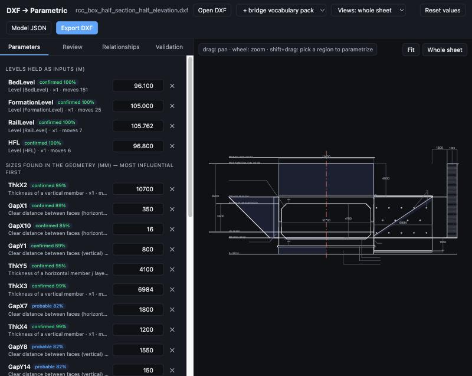
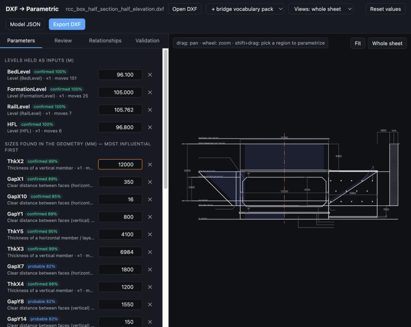

# Existing DXF → parametric CAD model, automatically

**Question.** Given a fully digitized GAD/DXF (lines, polylines, arcs, circles, dimensions, texts, hatches, blocks), can
we recover a *genuinely* parametric model (parameters → relationships → geometry, regenerating when a value changes)
without a hand-written rule engine per structure type?

**Answer, measured.** Mostly yes, and deterministically. A generic engine (no structure vocabulary in its code) reads
the DXF, finds the drawing's set-out lines, the sizes between them, its symmetry and repeats, ranks every candidate by
evidence, chooses *what drives what*, and writes every coordinate as an exact linear expression of the parameters. The
drawing regenerates in closed form with no iterative solver, and the original DXF is written back with only its
coordinates and stated numbers changed.

| | Today's *Make parametric* (aagento kernel) | This prototype |
|---|---:|---:|
| Design parameters recovered exactly from geometry only (17 independent families, 177 params) | **0 / 177** | **60 / 177 (34%)** |
| Same, when the drawing's own dimensions are present | 36 / 177 (20%) | **69 / 177 (39%)** |
| Regenerates the original exactly (all 17 families + 5 real DXFs) | yes | yes (max error 7e‑12 mm) |
| Real 1,943-entity AutoCAD GAD (`mib173.dxf`) | — | 204 parameters in ~1.5 s; 178 regenerate validly at ±10%; 195 dimensions re-rendered; file re-opens clean |
| Single-structure sections (2-cell box, girder deck, pier, retaining wall) | 7/9 · 3/9 · 5/11 · 4/7 | **9/9 · 8/9 · 9/11 · 6/7** |

"Recovered" means: after reverse-engineering the drawing *blind*, one inferred parameter, changed, reproduces exactly
what the original parametric program does when *its* parameter changes (shape compared; which point stays fixed is
treated as a free anchor choice). The independently authored programs are the 17 structure families in the Aagento
kernel library (RCC box half-section, box culvert, pipe culvert, pier, abutment, span, deck slab, girder deck, pile
group, well foundation, retaining wall, bridge GAD/plan, …), flattened to plain DXF.

The rest of this document: what exists in the repository (§1), the approaches compared (§2), what geometry can and
cannot tell you (§3), the architecture (§4), data structures (§5), algorithms (§6), solver strategy (§7), where AI
belongs (§8), the MVP and how to run it (§9), results and failure analysis (§10), validation (§11), and the plan to
bring it into aagento-bridge (§12).

---

## 1. What the repository already has

| Area | Where | What it does | Verdict for this problem |
|---|---|---|---|
| Bridge generators (14 families, ~237k lines) | `aagento-bridge/src/app/features/bridges/utils/*` (e.g. `rcc-box-railway/rcc-box-rule-engine.ts`, `*-view.ts`, `rcc-box-dxf-export.ts`) | Immediate-mode drawing scripts: a rule engine computes sizes, views draw them to canvas/DXF | The hardcoded approach this work replaces. Useful only as ground truth. |
| Template engine | `features/bridges/template-engine/` (`template.schema.ts`, `formula-solver.ts`, `expression-engine.ts`, masters `railway-rcc-box*.template.ts`) | Parameters (INPUT / COMPUTED / STATIC / API_FETCHED), mathjs formulas with `dependsOn`, lookup tables (RDSO), entity `parametricBindings`, `repeat` | Good *target* format (parameter binding); authored by hand — the RCC master has `entities: []`. |
| UPCE kernel (vendored) | `aagento-bridge/src/cad-engine/lib/` | Components whose every coordinate is an expression (`components/evaluate.ts`), sketches + DOF + DogLeg/LM + PlaneGCS (`upce/`, `solver/planegcsClient.ts`), DCEL/predicates, an `inference/` package (candidate detectors, clusterer, formula candidates, integer relations) | The right **runtime**: closed-form components regenerate, refuse whole, feed Author/Template mode, export DXF. The `inference/` package proposes low-level constraints; it does not choose drivers. |
| *Make parametric* | `components/fromDrawing.ts` → `CAD_MAKE_PARAMETRIC`, Aagento `UpceDocumentService.makeParametric` + `upce-entity-lift.ts` | Generic "datum" method: every distinct x/y is a datum; **dimensions** are the only source of parameters (Kruskal, chain first); everything else follows the nearest datum at a fixed offset; every vertex must come back | The closest existing thing. Measured: 0/177 without dimensions, 36/177 with. Arcs and bulges are dropped. |
| DXF I/O | `core/services/dxf-import.service.ts` (dxf-parser), `core/services/dxf-export/` (new AutoCAD-loadable writer, R12…R2018) | Robust import/export, verified on 6 real drawings | Reusable as-is. |
| Specs | `2D Canvas/docs/audit/UNIFIED_PARAMETRIC_CAD_ENGINE_MASTER_PLAN.md` Part VI–VII | The inference pipeline in prose: DCEL, predicates P1–P9, clustering, integer-relation formula search, perturbation gates, author review | Sound; this prototype implements a pragmatic version and adds the missing piece — **driver selection** (§6.5). |

**What is hardcoded today:** the generators' geometry and rules (every family restates `W = N·S + (N−1)·t + 2·t`), the
template masters' parameter lists and formulas, and the bridge vocabulary inside `fromDrawing.ts` (site-level roles,
"V.C."/"F.B." check words). **What is generic:** the component evaluator, expression language, regeneration with
invariants, the datum idea in `fromDrawing.ts`, the solvers, the DXF I/O. **What is missing:** inferring parameters
from geometry (not only from dimensions), choosing which sizes drive and which are results, symmetry/repeat/slope
intent, and a review surface for candidates with evidence.

---

## 2. Approaches compared

| | A. Pure deterministic geometry | B. Constraint solver / CAD kernel | C. Algorithmic reverse engineering | D. Optimization (fit P so geometry(P) ≈ drawing) | E. AI proposes, engine verifies | F. Agent loop |
|---|---|---|---|---|---|---|
| What it recovers | coincidence, H/V, collinear, parallel, offsets, loops | solves *given* constraints; infers none | A + symmetry, repeats, equal sizes, slopes, dimension anchoring, drivers vs results | good for noisy / scanned geometry; needs a model structure to fit | names, semantic roles, which redundant size is "the input", site levels | orchestration only |
| Accuracy on clean DXF | exact for low-level constraints | exact once constraints exist | exact regeneration; intent 34–39% exact single-knob (100% on clean sections) | approximate | depends; must be validated | = whatever it calls |
| Explainability | high | medium | **high (every value carries evidence)** | low–medium | medium (free text) | low |
| Handles under-/over-constraint | n/a | yes (DOF, redundancy) | by construction: spanning tree = exactly determined; non-tree = reported results | regularization | no | no |
| Arbitrary DXFs | yes | needs constraints | yes (generic rules only) | needs structure hypothesis | yes | yes |
| Cost / speed | ms | ms–s | **~1 s for 2,000 entities** | s–min | API cost per drawing | high (the live GAD runs cost real money) |
| Complexity | low | integration | medium (~3k lines incl. demo) | medium | low + guardrails | high |
| Delivery value alone | low (no parameters) | none without constraints | **high** | medium | low without C | low |

**Verdict: hybrid, deterministic-first.** C (with A inside it) does almost all the work; B's role shrinks to
*evaluation* because set-out drawings are linear in their sizes (§7); D is a later add-on for noisy drawings; E is a thin,
optional layer for naming and for resolving genuine ambiguities, always re-validated; F brings nothing for this problem.

---

## 3. What a static drawing can and cannot tell you

A single DXF is **one sample** of a design function. Anything that is a relationship *between samples* is invisible in
one drawing. That single fact explains most of the residual error.

**Recoverable deterministically (exact):** coincident points, horizontal/vertical, collinear edges (shared datums);
closed and nested outlines; parallel faces and the gaps between them; equal values; mirror symmetry (scored); congruent
repeated members and their pitch; slope ratios (1:1, 1V:1.5H, 1:12…); what a DIMENSION measures; which notes state a
size or a level ("HAUNCH 600 X 600", "FORMATION LEVEL 105.000"); every derived relation of the chosen drivers
(`Overall = 2·Wall + Span` falls out exactly).

**Recoverable with evidence (probable, reviewable):** which gaps are design values (round numbers, repetition,
dimensions, notes), which equal values are one parameter (same kind, same axis, mirrored, repeated), which sizes drive
and which are results (dimensioned first, members before totals, structure before levels), thin layers that follow what
they lie against (a PCC course projects past the box), loose level/water lines that bound nothing, member axes.

**Needs semantics (domain layer):** names (that *this* opening is the clear span), which stated levels are site inputs
(bed, formation, rail) versus derived (top of slab), that a flood level is checked against and never built from,
code-table relations (haunch from span, slab thickness from cushion — RDSO tables).

**Fundamentally ambiguous from one drawing:**
1. **Driver choice among redundant sizes** — deck width vs overhang, pitch vs clear gap between pipes, overall vs part:
   identical geometry, different behaviour on edit.
2. **Anchor** — which line stays put when something grows (left face, centre line, foundation).
3. **Coincidental equality** — top slab = bottom slab = 800 mm: one value or two?
4. **Round-but-derived values** — a dimensioned return-wall length that is really `f(height, slope)`.
5. **Topology growth** — where a 4th cell goes, what grows when spans are added.
6. **Rules across configurations** — lookup tables, min/max code rules: invisible in one sample, recoverable from a
   *family* of delivered drawings (§12, step 5).

The engine resolves 1–3 with explicit defaults and exposes each as a one-click review decision; 4–6 are reported.

---

## 4. Architecture

```
EXISTING DXF
  │  dxf_read      entities → items + points; roles from drafting conventions only
  │                (structural / reference axes / annotation / fixed sheet border)
  ▼
GEOMETRY        views (detect_views) · drawn patterns removed · loose lines marked
  ▼
DATUMS          every x and every y that coincide → one set-out line (tolerance 0.5 mm)
  ▼
RELATIONSHIPS   gaps between datums, each with how it was seen:
                faces facing each other (solid / void / open) · steps along an edge ·
                equal legs (chamfers) · slopes (ratio) · pitches of repeated members ·
                offsets from member axes · arcs (rigid) · DIMENSION entities
                + construction axes (drawn CL, each symmetric outline's own, whole-drawing mirror)
                + constraints report (H/V, perpendicular, coincident, collinear, parallel, concentric, symmetric)
  ▼
PARAMETERS      equal gaps of one kind/axis → candidate; confidence from evidence
                (dimension, repeat, mirror, note, round value, material)
  ▼  ← DOMAIN PACK (optional): pins stated site levels, names values; never geometry
  ▼  ← PERSON (review): accept / reject / rename / anchor
DEPENDENCY      per axis: spanning tree by evidence, then locality (§6.5);
GRAPH           centred gaps split about their axis; slopes keep their angle;
                non-tree gaps become RESULTS (worked-out relationships)
  ▼
PARAMETRIC IR   every datum = const + Σ coeff·param (exact); every entity point = datum + offset
  ▼
REGENERATION    evaluate (closed form) → invariants (no inversion, no collapse, no self-crossing, positive values)
  ▼
DXF WRITE       original file edited in place by handle; dimensions re-rendered; notes' numbers updated
```

Generic layer: `dxf_read`, `views`, `analyse`, `build`, `regen`, `dxf_write`, `pipeline`. Domain layer:
`domains/bridge.py` (≈80 lines: site-level words, water levels, naming). A test fails if any structure word
(culvert, girder, slab, pier, haunch, rcc, psc, bridge, rail, formation, …) appears in the generic engine's code.

---

## 5. Data structures

Defined in `src/dxf_autoparam/ir.py`; serialized by `pipeline.model_to_json` (`format: dxf-autoparam/1`).

```python
Item       { index, handle, dxftype, layer, role: structural|reference|annotation|fixed,
             pts: [(x,y)], vertex_pts, segments: [(i,j)], closed, bulges, radius, text, extra }
Datum      { id, axis: x|y, value, virtual, source: vertex|drawn-axis|loop-axis|global-axis, weak, items }
Gap        { id, axis, a, b, value, kind: solid|void|open|leg|run|rise|chain|pitch|offset|arc|dim|slope|diameter|ring,
             overlap, sample, sym_axis, dims[], cluster, lengthwise, slope: (x1,y1,x2,y2,ratio) }
Evidence   { kind: dimension|repeat|symmetric|text|round|not-round|material|void|overlap, weight, detail }
Cluster    { id, name, label, kind, axes, value, gaps[], confidence, status, evidence[], suggested, accepted }
             status: confirmed ≥0.85 · probable ≥0.65 · candidate ≥0.45 · weak (kept as fixed offset)
Constraint { kind, items[], confidence, kept_by: construction|parameter|reported, detail }
LinearForm { const, terms: {param: coeff} }                       # the expression of one datum
TreeEdge   { child, parent, how: gap|symmetric|slope|attach, gap, param, sign, amount }   # the dependency graph
Parameter  { name, label, value, unit, kind, axes, confidence, status, evidence, occurrences, suggested, affects }
Result     { gap, label, value, form, dimensioned }               # e.g. 7000 = 2·OpenX1 + 2·ThkX1 + ThkX4
Model      { parameters, forms{datum→LinearForm}, tree, results, roots, radius, text_links }
Decisions  { accept, reject, rename, anchor, pin{datum→name}, reference_only }
```

The JSON keeps the evidence with every candidate, the expression of every datum, and the binding of every entity point
(`item, pt, axis → datum, offset`) — so a model can be inspected, diffed, and re-applied without re-analysis.

Mapping to the aagento kernel (§12): `Parameter` → `ComponentParameter`; datum form → `ComponentFormula`
(`x7 = CL + 0.5*ThkX4`); entity point → primitive `XY` (`["x7", "y3 + 12.5"]`); text link → `TextDef` template
`"{OpenX1}"`; pinned level → `kind: "level"` parameter.

---

## 6. Algorithms

### 6.1 Normalize and classify roles
Explode nothing by default; keep INSERTs rigid at their insertion point. Role by drafting convention only: centre/axis
linetypes or layers → reference; dimension/text/hatch layers and annotation entity types → annotation; border/title
layers → fixed. Eight or more identical, evenly spaced parallel lines on one layer → a drawn pattern (hatching, courses)
→ annotation. A straight line whose ends touch no other vertex → **loose** (level/water/ground lines).

### 6.2 Datums
Cluster all structural x values (and y values) consecutively within tolerance; each cluster is a datum; each point is
bound to `(datum, offset)` with `offset = value − datum.value`, so regeneration at the defaults is exact.

### 6.3 Gaps (candidate relationships)
```
faces:   for each vertical face a (sorted by x):
            uncovered = a's y-extent
            for faces b to the right, nearest first:
               if b is loose: record (a,b) where in view; continue          # seen through
               overlap = uncovered ∩ b.extent → if > tol: record gap(a.x, b.x)
               uncovered -= b.extent;  stop when nothing is uncovered
         (same for horizontal faces)
chains:  for each straight edge, the vertices lying on it, in order → consecutive gaps
sloped:  equal run/rise that recurs (≥2) → LEG; a stated ratio → SLOPE (run follows rise); else RUN/RISE
arcs:    centre ↔ ends: rigid
axes:    drawn centre lines; each closed outline's own vertical axis when it mirrors onto itself;
         the whole drawing's mirror axis (≥60% of edges mirrored, ≥30% with a drawn CL);
         horizontal axes only when the whole drawing is ≥90% symmetric top-to-bottom (plans, not elevations)
centred: a gap whose middle lies on an axis it belongs to → splits half each side
repeats: congruent outlines / equal circles in a row → PITCH between their axes / centres
free ends: an edge end that touches nothing → OFFSET to the face it stops short of
dims:    DIMENSION defpoints → the datums they measure (evidence on that gap, or a DIM gap)
material: a sample point between two faces: inside a hatch → solid; else even–odd nesting of closed outlines
         → solid / void; outside everything → open
```

### 6.4 Parameters and confidence
Group gaps by `(kind, axis, value ± tol)` (legs across both axes). Score:

```
base(kind) + 0.35·dimensioned + 0.07·min(4, n−1) repeats + 0.10 mirrored/centred + 0.08 stated in a note
          + 0.05 round (×5 mm) − 0.30 non-integer (derived)      → clamp [0.02, 0.99]
```
Accepted by default when ≥ 0.45. A thin layer (gap > 8 × the faces bounding it) is a *length*, demoted so the steps
that tie it to its neighbour win.

### 6.5 Driver selection — the step that recovers intent
Per axis, a spanning forest over datums (union-find), pre-joined to the root (pinned levels; else the symmetry axis or
the drawn CL that gaps are centred on; else the lowest/left-most line). Gaps are taken in this order:

```
1. group     arcs  <  accepted strong (faces, legs, pitch, dimensioned)  <  accepted weak (steps, run, offsets, slopes)
                   <  weak strong  <  weak others          (a gap touching a loose-line datum counts as weak)
2. levels    gaps that touch a pinned level come after the structure's own gaps; lower level first
3. dims      dimensioned before undimensioned (the drawing's own design inputs)
4. material  known material (solid/void/legs/pitch) before unknown
5. locality  fewest major datums strictly between its ends (chain dimensioning: members first, totals after)
6. confidence, then value
```
A gap joining two different components becomes a tree edge (a centred gap joins both ends to its axis); one closing a
loop is a **result**. Leftover datums attach to a datum of the same entity if one is set (an isolated slope keeps its
run), else to the nearest. Then a breadth-first walk from the roots writes each datum:

```
child = parent ± (param + residual)          gap edge of an accepted cluster
child = axis ± ½(param + residual)           centred gap
x_end = x_start + ratio · (y_end − y_start)  slope (heights are solved first)
child = parent ± constant                    weak gap / attachment
```
plus a constant that makes every datum exact at the defaults. Results are the difference of their end forms — e.g.
`7000 = 2·OpenX1 + 2·ThkX1 + ThkX4`. This replaces integer-relation (PSLQ) search: the coefficients are exact integers by
construction.

### 6.6 Regeneration and refusal
Evaluate forms → move every bound point → check invariants (closed outlines keep orientation and do not self-cross,
edges do not collapse or flip, values stay positive). An edit that breaks one is refused with the reason; the demo keeps
the previous valid drawing.

---

## 7. Solver strategy

**Finding: a set-out drawing is linear in its sizes.** With angles held (slopes keep ratios, chamfers keep 45°), every
coordinate is `const + Σ coeff·size`. The dependency graph is a tree, so the system is triangular and solved by
evaluation. No Newton iterations, no convergence failures, no branch jumps, exact results, and over-/under-constraint is
handled structurally (tree = exactly determined; extra relations = reported results).

| Candidate | 2D | Solves | Keeps dependencies | Regenerates | Under-/over-constrained | Infers | DXF | Our stack | Local | Browser | 1000s of entities | Licence |
|---|---|---|---|---|---|---|---|---|---|---|---|---|
| **Closed-form linear set-out (this work)** | ✓ | by construction | ✓ tree | ✓ exact | tree / reported results | ✓ | via ezdxf / Aagento writer | Python now, TS port | ✓ | ✓ (TS) | ✓ ~1 s | ours |
| Aagento component evaluator | ✓ | expressions | ✓ DAG | ✓ | refuse-whole invariants | ✗ | via editor | ✓ native | ✓ | ✓ | ✓ | ours |
| PlaneGCS (FreeCAD; WASM already in aagento deps) | ✓ | ✓ DogLeg/LM | constraints only | ✓ iterative | DOF + redundancy | ✗ | ✗ | ✓ (`planegcsClient.ts`) | ✓ | ✓ | slower at sheet scale | LGPL |
| SolveSpace libslvs | ✓ | ✓ | constraints only | ✓ | ✓ | ✗ | app only | C | ✓ | via WASM | ok | **GPL — conflicts with the no-GPL rule** |
| FreeCAD Sketcher (app) | ✓ | ✓ | ✓ | ✓ | ✓ | missing coincident/H/V checks only | ✓ | heavy desktop | ✓ | ✗ | ok | LGPL |
| OCCT / CadQuery | 3D-first | partial | ✓ | ✓ | — | ✗ | via export | heavy | ✓ | ✗ | ok | LGPL / Apache |
| SymPy / SciPy | — | algebra / least squares | — | — | — | ✗ | ✗ | Python | ✓ | ✗ | — | BSD |

**Recommendation.** Closed-form evaluation for the set-out (this engine compiled into Aagento components), PlaneGCS
only for the nonlinear remainder when it appears: angle or ratio as a *parameter* (product of parameters), tangency,
arcs through points, rotated local frames. Least squares (D) only for noisy/hand-traced drawings, to snap near-equal
values before inference.

---

## 8. AI: where it helps and where it must not be used

| Use AI | Do not use AI |
|---|---|
| Naming values from the drawing's words and context ("this 10700 opening is the clear span") | Coordinates, offsets, any geometry |
| Choosing between *equivalent* parametrizations (which redundant size is the design input) — each choice re-validated by regeneration | Deciding a relationship holds (the engine checks it on the drawing) |
| Classifying views (section / elevation / plan) and levels (site vs derived) when notes are ambiguous | Regeneration, DXF writing, validation |
| Reading raster/scanned drawings (future, upstream of this engine) | Overriding a refused edit |

Measured here: the deterministic engine reaches its results with **no model calls**; the semantic decisions it needed
(site levels, water levels, names) were three short word lists in a domain pack. An LLM would sit in the same slot as
that pack — producing `Decisions` (rename / pin / accept / anchor) that the engine validates — never geometry.

---

## 9. The MVP (this folder)

```
dxf-autoparam/
  src/dxf_autoparam/   ir · dxf_read · views · analyse · build · regen · dxf_write · pipeline · bench · server · cli
  src/dxf_autoparam/domains/bridge.py   the only bridge vocabulary
  src/dxf_autoparam/static/index.html   the demo canvas
  examples/            8 drawings (2-cell box, RCC box half-section/half-elevation, girder deck, deck slab, pier,
                       retaining wall, well, and a 3-cell box drawn as loose LINEs only)
  fixtures/library/    17 families as DXF + ground-truth variants (JSON)
  tools/               export_library_oracle.ts (reads the aagento kernel, read-only), json_to_dxf.py, make_examples.py
  tests/test_engine.py 34 tests
```

```bash
uv run dxf-autoparam serve examples/three_cell_box_lines.dxf --domain bridge     # http://127.0.0.1:8765
uv run dxf-autoparam analyse examples/two_cell_box_section.dxf --validate --json model.json
uv run dxf-autoparam regen examples/two_cell_box_section.dxf --set OpenX1=4000 -o box_4000.dxf
uv run dxf-autoparam views drawing.dxf
uv run dxf-autoparam bench
uv run pytest -q
```

Demo flow: open a DXF → (pick a view or shift-drag a region) → parameters appear with status, confidence, occurrences
and what they move (hover highlights it) → click a name for its evidence, double-click to rename, ✕ to keep a size fixed,
Review tab to promote other candidates or change the anchor → type a value → the drawing regenerates (or the edit is
refused with the reason) → Relationships tab shows the worked-out formulas live → Export DXF.

MVP behaviour on the RCC box culvert (the brief's example), all found without box rules:
- 2-cell box: `OpenX1 = 3000 (×2)`, `ThkX1 = 350 (×2)` outer walls, `ThkX4 = 300` mid wall, slabs, `Haunch = 150 (×6)`;
  discovered `7000 = 2·OpenX1 + 2·ThkX1 + ThkX4`, `3750 = ThkY2 + OpenY1 + ThkY3`; all 9 values regenerate validly.
- 3-cell box drawn as 33 loose LINEs: one span shared ×3, one mid wall ×2; discovered `8600 = 3·Span + 2·Mid + 2·Wall`;
  span 2500 → 3500 grows all cells about the centre line; the note "3 CELL BOX 2.500 X 2.000 m" becomes "3.500 X …".
- RCC half-section/half-elevation: clear span 10700 → 12000 grows symmetrically about the CL; site levels stay;
  discovered `cushion 4000 = FormationLevel − BedLevel − 4100 − 800`, `V.C. 3400 = BedLevel − HFL + 4100`.

---

## 10. Results and failure analysis

| Family | Params | Make parametric today (with dims) | Prototype, geometry only | Prototype, with dims |
|---|---:|---:|---:|---:|
| bridge GAD (assembly) | 37 | 0 | 5 | 4 |
| RCC box half-section / half-elevation | 24 | 6 | 3 | 6 |
| abutment elevation | 15 | 1 | 2 | 3 |
| bridge plan | 15 | 0 | 3 | 4 |
| pier elevation | 11 | 5 | 9 | 9 |
| box culvert GAD | 10 | 2 | 3 | 3 |
| deck slab section | 10 | 2 | 5 | 4 |
| 2-cell box culvert section | 9 | 7 | 9 | 9 |
| girder deck section | 9 | 3 | 8 | 8 |
| well foundation section | 9 | 4 | 2 | 4 |
| retaining wall section | 7 | 4 | 2 | 6 |
| pipe culvert section | 6 | 0 | 1 | 1 |
| span elevation | 5 | 1 | 4 | 4 |
| pile group plan | 4 | 1 | 1 | 1 |
| railing post / run, level set | 6 | 0 | 3 | 3 |
| **Total** | **177** | **36 (20%)** | **60 (34%)** | **69 (39%)** |

Strict scoring (same fixed point as the ground truth): 49 geometry-only, 59 with dimensions. With the bridge pack:
67 (the library's own level handling differs from site-level pinning in two families). All runs: identity exact.

Why the rest fail — in order of how often:
1. **Redundant drivers** (§3.1): the library drives deck width by overhang, pipe spacing by clear gap, return-wall length
   by slope; the drawing shows the same geometry either way. Fix: one click in Review; later, AI or a family of drawings.
2. **Multi-structure assemblies** (bridge GAD/plan, abutment): views and members share coordinates, so one value moves
   things the library keeps separate. Fix: view selection (implemented), per-member scoping (next).
3. **Coincidental equality** (top = bottom slab, PCC = wearing course = 150): merged as one value. Fix: split in review.
4. **Values that are functions across configurations** (haunch from span, cushion rules): not in one drawing.
5. **Not yet implemented:** cell *count* as a parameter (topology), arc radius as a parameter, ratio as a parameter.

On five real DXFs (R12 GAD, the double-box GAD, an L-section, `gad_ezdxf_b`, and the 1,943-entity AutoCAD sheet
`mib173.dxf`): identity exact on all; 82–100% of inferred values regenerate validly at ±10% (89%, 82%, 87%, 90%, 100%;
the rest are flagged with
the entity that would flip — exactly what review is for); every written file re-opens with 0 audit errors and no new
fixes (mib173's 300 pre-existing fixes are in the source file).

---

## 11. Validation strategy

| Check | How | Status |
|---|---|---|
| Identity | regenerate at defaults; max point error over every entity | implemented — 0 to 7e‑12 mm |
| Parameter behaviour | every value ±10%: orientation, collapse, flip, self-crossing, positivity | implemented (`validate`) |
| Topology | datum order inversions under change; shared points stay shared (by construction) | implemented |
| Independent oracle | 8 design changes on a 3-cell box drawn by a separate generator: one inferred value must reproduce each | implemented (tests) |
| Intent benchmark | 17 kernel families × 177 single-parameter variants | implemented (`bench`) |
| DXF round trip | write → strict re-open/audit → re-analyse → same values; entity count unchanged; dimensions re-rendered | implemented |
| Engine genericity | AST scan: no structure words in the generic engine's identifiers or strings | implemented (tests) |
| Production generators as oracle | run `rcc-box-railway` etc. at two inputs, reverse-engineer one, compare to the other | next (needs a Karma harness) |
| AutoCAD | open exports in AutoCAD itself | not verified (no AutoCAD here) |

---

## 12. Bringing it into aagento-bridge

Keep the prototype as the reference implementation and port the engine to TypeScript on the Aagento side (the kernel
stays byte-close to upstream). Nothing below exists yet.

| File (aagento-bridge) | Purpose | Depends on | Implementation |
|---|---|---|---|
| `src/app/features/cad/components/cad-editor/features/upce/auto/auto-param.types.ts` | IR of §5 | — | port of `ir.py` |
| `…/upce/auto/auto-param.analyse.ts` | datums, gaps, axes, repeats, clusters, evidence | kernel `geometry/tolerance` | port of `analyse.py` |
| `…/upce/auto/auto-param.build.ts` | driver selection, linear forms, results | — | port of `build.py` |
| `…/upce/auto/auto-param.compile.ts` | IR → `ComponentDefinition`: parameters, one formula per datum, primitive `XY` as datum names, texts `{Param}`, pinned levels as `level` parameters | kernel `components/types`, `evaluate` | new; self-check = kernel's "every vertex comes back" |
| `…/upce/auto/auto-param.validate.ts` | ±10% sweep, invariants | kernel `evaluateComponent`, `features/upce/model/regeneration.ts` | port of `validate` |
| `…/upce/auto/domains/bridge.ts` | site levels, water levels, names | `auto-param.types` | port of `domains/bridge.py` |
| `…/upce/services/upce-document.service.ts` (modify) | `installInferred(definition, consumedEntities)`: `CAD_PUT_DEFINITION` + `CAD_INSERT_COMPONENT` + remove source entities, one undo step | existing reducer | mirrors `makeParametric` |
| `…/upce/services/auto-parametrize.service.ts` | entities → `liftEntities` → analyse → build → compile → install | the above | new |
| `…/upce/author-panel.component.ts` (modify) | "Auto-parametrize" beside "Make parametric"; review list (status, confidence, evidence, accept/reject/rename, anchor) | service | UI only; Values tab then edits as today |
| `…/upce/auto/*.spec.ts` + `auto-param-dxf.run.ts` | specs; real-DXF harness like `dxf-roundtrip.run.ts` | Karma | port of `tests/` + benchmark |
| kernel gap: arc primitive | arcs as parametric primitives (today the lift drops them) | upstream `components/types.ts` | needed before arcs/bulges can be carried |

Alternative: run this Python engine as a local service next to the existing drafter sidecar and have the editor call
it. Faster to ship, but a second runtime; the port is preferable once the review UX is settled.

**Next steps, in order of value:**
1. Run it on your own delivered DXFs (one per family). Each miss is either a generic rule to add or a review decision —
   the benchmark makes both measurable.
2. Per-member scoping for multi-structure sheets (abutment + pier + deck on one sheet).
3. Cell/span **count** as a parameter: the pitch detector already finds the repeated unit; regenerate by copying it.
4. Arc radius and slope ratio as editable parameters (the only places a nonlinear solver is needed — PlaneGCS).
5. **Families of drawings:** given N delivered GADs of one type, fit the cross-configuration relations (haunch vs span,
   cushion rules) — the one place machine learning / regression is genuinely needed.
6. Optional LLM naming / driver suggestions behind the `Decisions` interface, re-validated by regeneration.

---

### Demo screenshots

RCC box half-section / half-elevation, parametrized from its DXF (generic engine + bridge pack). Clear span 10700:



Clear span typed as 12000 — the box grows about the centre line, walls and slabs keep their sizes, the embankment
slopes keep their angle, the site levels stay where they are:


