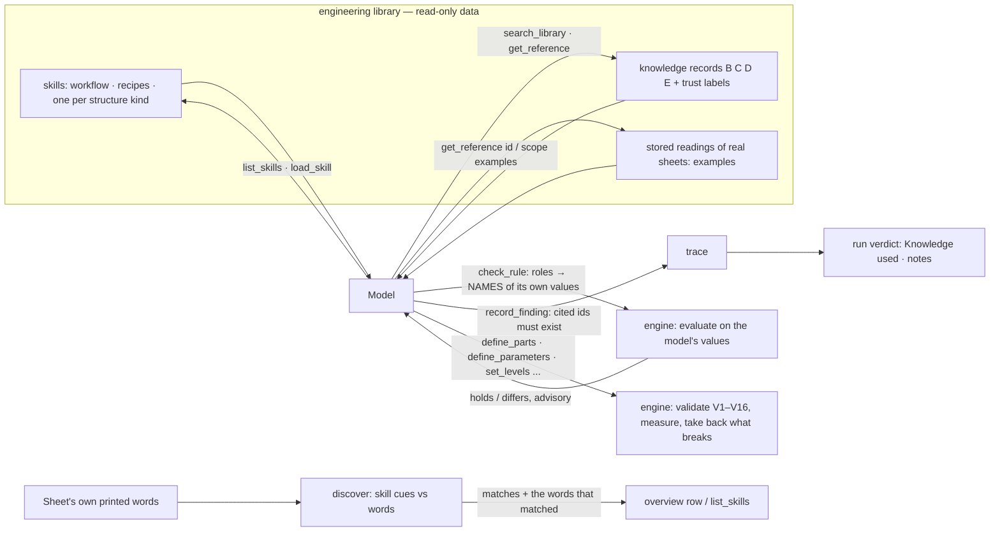

# The engineering library — domain knowledge the agent retrieves on demand

What it is: the foundation model's `agent-context` (engineering knowledge about bridge and culvert General Arrangement Drawings: 2,914
reference, vocabulary, disputed and operational records, 14 skills, 55,777 stored readings of drawings) made available to the agent as
**skills, definitions and rules it can look up while it works** — and nothing else. It is context. It never supplies a value of the drawing in
hand: every size, level and relation still comes from the drawing, measured and checked by the engine.

It is a *domain library*: a folder of data under `src/dxf_autoparam/knowledge/library/<domain>/`, switched on with the domain pack of the
same name (`--domain bridge`, `options.domain`, `AUTOPARAM_DOMAIN`; the page preselects it when the sheet's own printed words match).
Without a pack the model sees none of it, and nothing in the engine, the prompts or the tool descriptions names a kind of structure
(`tests/test_domain.py`, `tests/test_library_harness.py`).

## The four kinds of material, kept apart

| Kind | Where | Who changes it |
|---|---|---|
| **Source knowledge** — what the engineering material says | `knowledge/agent_context/` (migrated; `MIGRATION.json` holds the sha256 of every file; large data stored gzip) | nobody here. Re-run `tools/migrate_agent_context.py` when the source changes |
| **Skills and recipes** — how this agent uses it | `knowledge/library/<domain>/skills/*.md`, `domain.json`, `protocol.md` | a person |
| **Indexes** — the token index, label index, ontology maps | in memory, built on first use (about 0.5 s) | generated, never stored |
| **Runtime state** — what a run retrieved, checked and recorded | the run's events and `verdict.knowledge` | the run |
| **Graded knowledge** — aagento-bridge's families, formulas and level chains, rules, conflicts, defaults and sources, each with its status | `knowledge/library/bridge/graded/` (`PROVENANCE.json`: repository, ref, commit, sha256 of every file) | nobody here. Corrected in aagento-bridge, imported again: `uv run python tools/import_graded_knowledge.py` (`--check` compares) |
| **The identification vocabulary** — the words a GAD uses for what it is (kinds, crossings, status, carried lines and counts, spans, loading, facts) and the configuration relations | `knowledge/library/bridge/identify.json`, read by `dxf_autoparam/identify.py` | a person (tune it on real sheets: `tests/test_identify.py`) |

The source folder is **only read** — by the migration tool, once. The runtime reads the migrated copy and never needs the original again
(`tests/test_migration.py` runs with the source folder absent and fails if any project code points at it).

## What was migrated, and how it became usable

| Source | Becomes | Used by |
|---|---|---|
| `skills/families/<family>/SKILL.md` (8) | a **structure skill** per kind of structure, parsed section by section (recognition and look-alikes, components, rules, hazards, abstain conditions, sources), plus a generated `representation` (the ontology's structure classes, repeated unit, required facts, views, level chain) and `conventions` (the knowledge family's drawing conventions and common misreadings) | `list_skills`, `load_skill` |
| `skills/<general>/SKILL.md` (5) | adapted into the authored recipes `read-the-drawing`, `name-and-bind-sizes`, `relate-views-and-levels`, `handle-uncertainty` and the workflow `gad-workflow` (the originals are written for a repository command line and stay migrated, unedited, as each recipe's `derived_from`) | `load_skill` |
| `knowledge/knowledge.jsonl` (2,914 records) | the **search index** and the **vocabulary of printed labels** (243 labels → part / structure / level classes) that discovery matches the drawing's words against | `search_library`, `get_reference`, `check_rule`, `discover` |
| `registry/observations.jsonl` (readings of 17 sheets) | **examples**: how parts, levels and relations were stated on real sheets, as a bounded compact reading | `search_library(scope=examples)`, `get_reference(<sheet>)` |
| `registry/issues.jsonl`, `registry/sources.jsonl` | references (`issue:…`, sheet ids) so a citation resolves | `get_reference`, `record_finding` |
| `schemas/`, `README.md`, `reports/`, `packs/`, `agentctx/`, `tests/` | kept for provenance and for rebuilding the registry from the source repository (not present here); not used at runtime | — |

## How the harness uses it (observe → retrieve → plan → act → verify → correct)

1. **Observe.** The run already looks at pictures and `inspect_sheet`. The harness also reads the sheet's printed words (text, multi-line
   text, attributes, dimension overrides) and **discovers** which skills' cues they match. Structure labels (a printed word that names a
   kind of structure) dominate; part labels only break ties and are weighted by how few skills share the part. The result carries the
   words that matched. It is a lead: the model confirms the cues on the drawing. A drawing nothing matches gets no match and works as
   before.
2. **Retrieve, progressively.** The first request carries only a catalogue row (skill ids and the matches). `load_skill` returns a
   working set within 9,000 characters and lists every section it left out with its size; sections are asked for by name, long ones by
   offset. `search_library`, `get_reference` are bounded; one run has a budget of library text (160,000 characters by default,
   `options.library_budget_chars`), after which retrieval says so while cheap tools stay open.
3. **Plan, act.** The existing tools, unchanged: the engine validates every batch and takes back what breaks the drawing.
4. **Verify.** `check_rule` evaluates a documented definition (a formula record) on values the model **bound by name**; a number is
   refused. The result is `holds` / `differs` (expected, measured, difference) or `not_evaluable` (what is missing). It is advisory: a
   difference is a question about which size or datum was bound. Records the library marks disputed carry their dispute with the answer.
5. **Correct.** The loop's own limits apply to library calls (twelve turns of only looking and the loop asks for edits or a finish).
6. **Leave a trace.** `record_finding` (`applied`, `assumption`, `conflict`, `gap`, `proposal`); a library id cited as evidence must
   exist or the finding is refused. A proposal is a note for a person: nothing is ever merged into the library.

The verdict (`verdict.knowledge`, and `notes`) says: which skills and sections were loaded, which references read, how many characters,
which definitions were checked and how they came out, the findings by kind, and any cited id that did not exist. It never makes a run fail:
the library is context.

## The tools (read-only; none edits the drawing)

| Tool | Does | Bounded by |
|---|---|---|
| `list_skills` | catalogue (section sizes where the model is likely to load) and the matches for this drawing | compact (about 7k chars) |
| `load_skill(id, sections?, offset?)` | one skill, section by section | 9k default, 24k explicit |
| `search_library(queries, categories?, topics?, families?, limit?, scope?)` | records by words, each with category and review state; or example sheets | 25 hits |
| `get_reference(id, full?)` | one record (kb:, chunk:, ontology:, issue:, skill:, observation, sheet) | 3.5k, 24k with `full` |
| `check_rule(rule, bind, tolerance_mm?, unit?)` | evaluate a documented definition on bound names | arithmetic only (the engine's safe evaluator) |
| `record_finding(findings)` | say what was applied / assumed / in conflict / missing / proposed | 200 per run |

From a terminal, without a model: `dxf-autoparam library list | search WORDS [--topic formula] | show ID [--section S] | discover drawing.dxf`.

## Where each stage of a GAD-to-DXF workflow lives

This project parametrizes an EXISTING, digitised DXF; it does not draw a new one. The stages map onto what already exists, and the library is
retrieved at the stages where knowledge helps. Nothing was added that duplicates an existing stage.

| Stage | Where | Library's part |
|---|---|---|
| GAD understanding | `inspect_sheet`, `zoom_view`, `describe_views`, the engine's segmentation and regions | `list_skills` matches the printed words; `read-the-drawing` |
| Knowledge retrieval | `list_skills`, `load_skill`, `search_library`, `get_reference` | the library itself |
| Engineering representation | `define_parts`, `define_parameters`, `set_levels`, `set_formulas`, `share_sizes`, `state_plan` (the closed-form datum program, shared values, the stated plan across views) | `name-and-bind-sizes`, `relate-views-and-levels`; a structure skill's `representation` lists what to look for |
| Plan | `account_instruction`, `propose_plan`, `state_plan` | `gad-workflow` |
| DXF construction | the engine: `regen` / `dxf_write.write_dxf` regenerate the drawing from the program (`dxf-autoparam regen … -o out.dxf`) | — (never written by the model) |
| Verification | the engine on every batch (V1–V16, no fixed line moves, the drawing reproduced exactly), the finish gate, `dxf_write.audit` on the regenerated file | `check_rule` for documented definitions (advisory) |
| Correction / completion | the loop's refusals with `failure.repair`; `ask_person`; the verdict | `handle-uncertainty` |

The brief's illustrative tool names map to: `inspect_gad` = `inspect_sheet` + `zoom_view`; `extract_drawing_parameters` = `find_values` +
`inspect_candidates` + `define_parameters`; `validate_geometric_constraints` = the engine's validation of every batch (and `what_moves`,
`propose_plan`'s measurement); `validate_dxf` = `dxf_write.audit`; `record_execution_findings` = `record_finding` plus the run's event log.

## Trust, as the source states it and as this project keeps it

- Almost every record is `seed_unreviewed`; `NORMATIVE` / `DERIVED` labels are labels, not verification. Both are shown with every item.
- Category D (proposed or disputed) is flagged `not_accepted` in search results and is never presented as a rule.
- Expressions are text (`executed: false` in the source). Here a definition is evaluated only through `check_rule`, on the model's own
  values, advisory.
- Where the library and the drawing disagree, the drawing wins and the disagreement is recorded. Nothing is "fixed" by moving a line.
- The library holds no standard dimensions the agent could copy: the source's records say so (typical spans, cushions and heights are
  taken from drawings, not from memory), and `check_rule` refuses a bare number.

## Extending it

- **A recipe or a convention:** a new `knowledge/library/<domain>/skills/<id>.md` — a JSON front matter block (`id`, `title`, `kind`,
  `purpose`, `applies_to`, `tools`, `related`, `derived_from`) then `## ` sections (`Purpose`, `Applicability`, `Required inputs`,
  `Recognition cues`, `Prerequisites`, `Engineering rules`, `Procedure`, `Dependencies`, `Outputs`, `Validation`, `Failure handling`,
  `Source traceability`). It is picked up on the next run.
- **A new kind of structure:** a skill for it under the source's `skills/families/<name>/SKILL.md` (same headings), its structure class
  and parts in the ontology records, and its printed labels as `ontology:terminology` records. Discovery uses those records only.
- **More reference material:** another folder of the `agent-context` shape listed in `domain.json` `sources`; or append records to
  `knowledge.jsonl` (schema: `schemas/knowledge-record.schema.json`).
- **Another domain** (a different kind of drawing): a folder `knowledge/library/<name>/` with its `domain.json`, `protocol.md`, skills,
  and a domain pack `knowledge/<name>.json`. `AUTOPARAM_LIBRARY_DIR` points the process at libraries kept elsewhere.
- Re-run the migration when the source changes: `uv run python tools/migrate_agent_context.py` (the tool checks the result against the
  source and `--verify-only` checks it against its manifest).

## What a sheet says it is, and the graded knowledge behind it

`identify_structure` (a library tool) reads the sheet's printed words with `identify.json`: the kind and what is existing / proposed, the
look-alikes set aside, what it crosses, each carried line named on the sheet and the configuration that makes, spans, loading, number,
chainage, standard drawings and codes cited — each with the words and where they are printed. With it comes the graded card of that kind
(`Library.family_card`): capability, components, what must be known, its level chain, formulas and rules with their status, open questions
(conflicts KC-n) and the configuration relations written with the count read. `check_rule(rule='graded:<id>', bind={…})` evaluates a graded
formula or relation on the agent's own named values. The first look at the sheet carries the one-line reading (`the_words_say`).

Statuses are the source's and are never promoted: DERIVED is geometry; NORMATIVE cites a verified clause (the IRBM 2024 copy in hand);
COMMON_PRACTICE, ASSUMPTION, DISPUTED and UNKNOWN are never values. Configuration formulas are identities over values read from the drawing.

### The RDSO slot (the owner adds the standard drawings later)

The library holds no RDSO number: no formation width or track centre per configuration (KC-13 open), no standard box, slab or pipe sizes. GADs
cite the sheets they follow (`RDSO/B-10152/1R`, `RDSO/B-10155/10`, `RDSO/BA-10236` — `identify` lists them as `standard_drawing` facts). When
the owner adds those PDFs:

1. Keep them outside the repository's code (they are large and licensed): a folder the library points at, like the IRBM 2024 copy.
2. Record each as a source in `graded/sources.json`'s shape (id, title, edition, `trust: VERIFIED_LOCAL`, sha256, path) — in aagento-bridge,
   then import again, so both projects read one register.
3. Index each sheet with page numbers (the clause index of `irbm-2024.json` is the pattern) and link the drawing ids GADs cite to their sheet.
4. Promote a value only with its sheet and clause: a rule NORMATIVE on a verified sheet; a size table as a relation to check on the drawing's
   own values (`check_rule`), never a value written into a drawing.

## Limits, said plainly

- **The matching is the labels' own coverage.** A drawing that prints none of the vocabulary (an unusual language, a scanned title that
  is a picture) matches nothing; it works as before.
- **Two structures printed are both reported** (an arch "extended as a box"): the engine does not choose; the skills' look-alike lists
  say how, and `ask_person` is for the rest.
- **Nothing here is human-verified.** The source says so for every record; this project does not promote anything.
- **Rule checks cover definitions that have an expression** (63 formula records); rules written as prose (level order, clearances) are
  read by the model and cited, not evaluated.
- **Whether a model uses the library well is a property of the model.** The harness makes the retrieval cheap, bounded, traced and
  checked; the tests drive it with a scripted model. A live run's behaviour is measured only when a live run is made.
